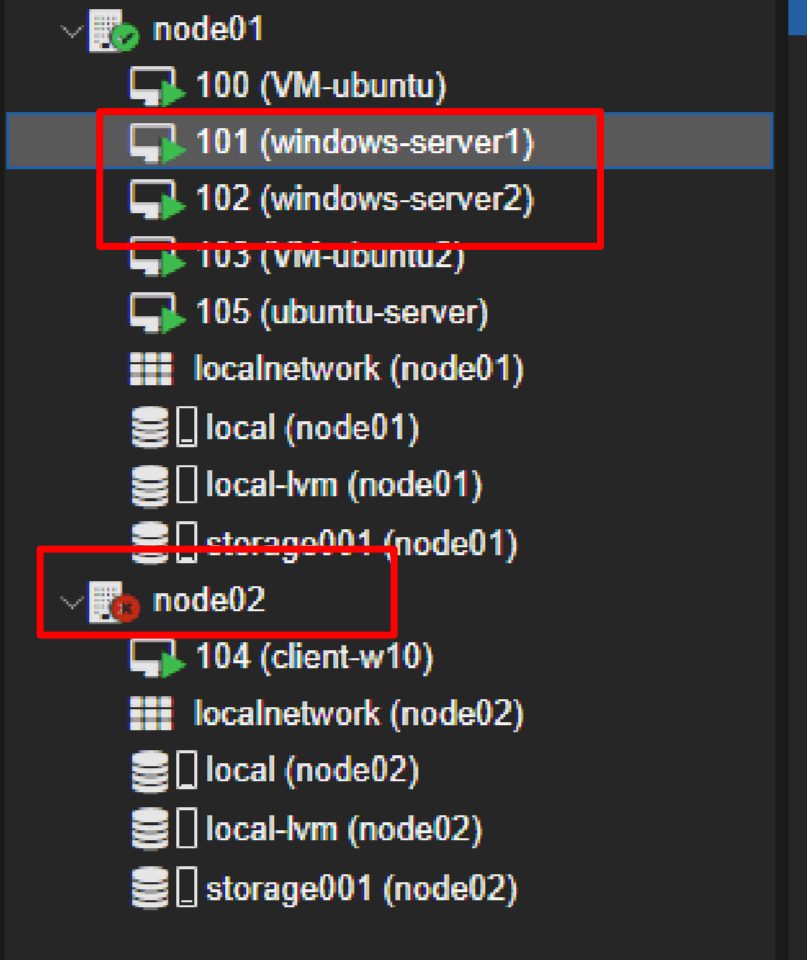
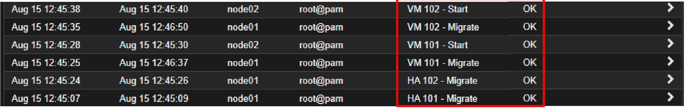
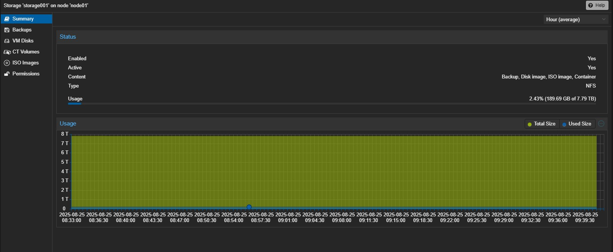
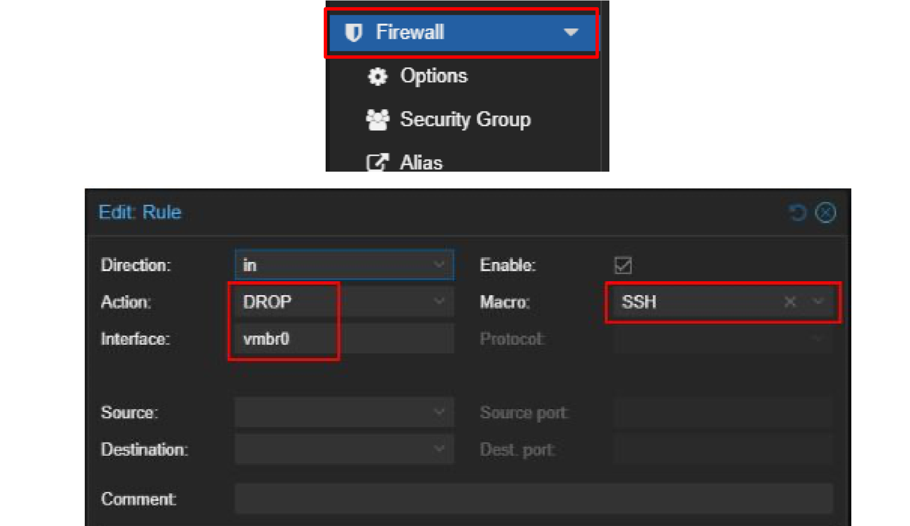

# Proxmox VE High-Availability Cluster with Shared NAS Storage

Design and deployment of a **fault-tolerant virtualization platform** on real hardware: a two-node **Proxmox VE** cluster on HP ProLiant servers, with VM disks on a shared **NAS over NFS**, so that if a physical server fails its VMs are **automatically restarted on the surviving node**.

> Internship project — SNRT, Rabat, August 2025.

   

---

## Physical architecture

| Component | Role |
|---|---|
| 2 × **HP ProLiant DL360p Gen8** | Cluster nodes (main + backup), Proxmox VE installed on bare metal |
| **LenovoEMC px6-300d NAS** | Shared storage: a 7.2 TB volume exported over **NFS** to both nodes |
| Layer-2 switch + patch panel | Server-room cabling between nodes, NAS and LAN |
| KVM console | Keyboard / video / mouse access to both servers during installation |

```
                ┌──────────── LAN / management ────────────┐
                │                                          │
        ┌───────▼───────┐                          ┌───────▼───────┐
        │   node01      │◄──── Corosync (knet) ───►│   node02      │
        │ HP DL360p G8  │                          │ HP DL360p G8  │
        └───────┬───────┘                          └───────┬───────┘
                └──────────────► NFS ◄─────────────────────┘
                          LenovoEMC px6-300d NAS
                (VM disks, ISO images, backups — "storage001")
```

## Implementation

1. **Installation** of Proxmox VE on both servers from a bootable USB (ISO checked by SHA-256), static management addressing on the `vmbr0` bridge, host names and `/etc/hosts` aligned on both nodes.
2. **Cluster creation** (`pvecm`) and node join, Corosync over knet with secure authentication.
3. **Shared storage:** NFS share created on the NAS with host access restricted to the cluster, then added in Proxmox as one storage for **disk images, ISO images, containers and backups**.
4. **Private NAT network:** a second bridge `vmbr1` for an isolated VM subnet, with an `iptables` **MASQUERADE** rule to reach the outside through `vmbr0`.
5. **Firewall:** enabled at cluster level (`/etc/pve/firewall/cluster.fw`), with a rule that **drops SSH** to the cluster and a second rule that **accepts SSH from a single authorised host** only.
6. **Users & permissions (RBAC):** a group for interns, individual accounts, and roles such as `PVETemplateUser` or `NoAccess` assigned to groups rather than users.
7. **ISO library & VMs:** ISO images stored on the NAS; VMs created for Ubuntu Desktop / Server, two Windows Servers and a Windows 10 client.

## The 2-node quorum problem — and how it was solved

A Proxmox cluster only acts while it has **quorum** (a majority of votes). With two nodes of one vote each, losing one node leaves 1 vote out of 2 — **no majority**, so the survivor freezes and HA cannot restart anything.

| Option | How it works |
|---|---|
| **Vote weighting in Corosync** *(implemented)* | Main node = 1 vote, backup node = 2 votes → 3 votes in total; the backup node alone keeps a majority and its HA manager can restart the VMs |
| **QDevice** *(studied)* | A lightweight external arbiter adds a third vote, so either node can survive alone |

## Validation

| Test | Result |
|---|---|
| **High availability** | HA enabled for the two Windows Server VMs; after **node02 was shut down**, the cluster kept quorum and both VMs were **migrated and restarted on node01** automatically |
| **Live migration** | Running VMs moved between nodes without being stopped |
| **Firewall** | SSH from an unauthorised machine timed out; SSH from the single allowed host succeeded |
| **NAT network** | Connectivity of VMs on the private `vmbr1` subnet through the host's NAT checked |

**node02 down — the cluster stays operational:**



**HA migrations and restarts logged by Proxmox:**



**Shared NFS storage on the NAS:**



**Firewall rule dropping SSH:**



## Skills demonstrated

Proxmox VE · KVM virtualization · clustering · Corosync & quorum · high availability · live migration · NFS / NAS shared storage · Linux bridges & NAT (iptables) · firewall · RBAC · server hardware (HP ProLiant) · troubleshooting

---

**Author:** Khaoula Belhaj — final-year engineering student, Communicating Systems & Computer Security, ENSA Fez · [LinkedIn](https://linkedin.com/in/khaoula-belhaj-1999163a6)
